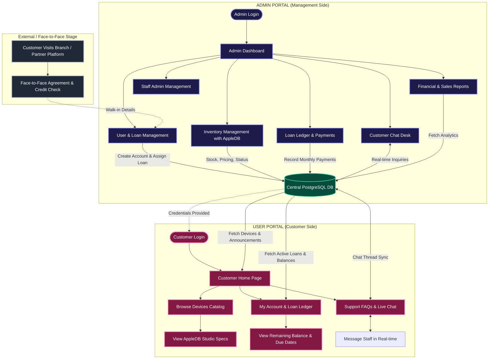
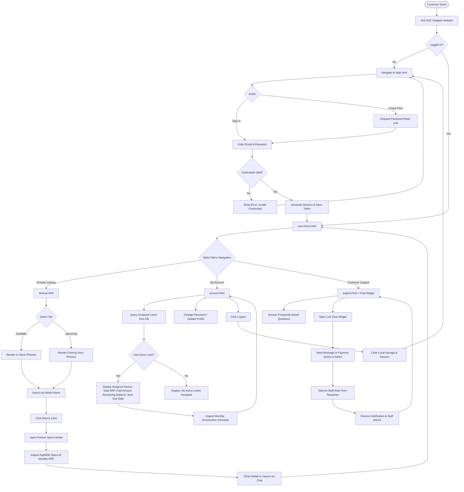
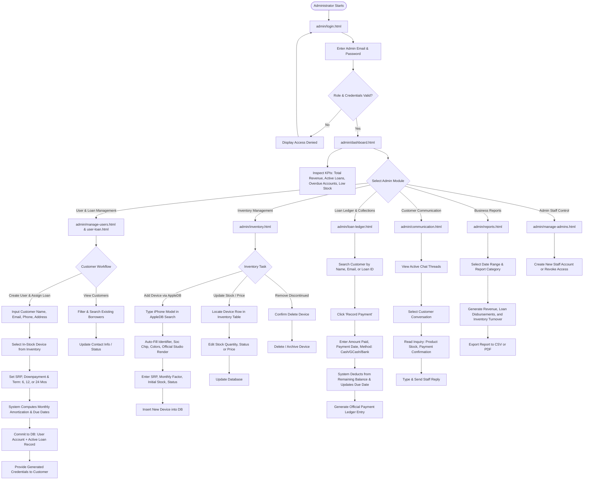
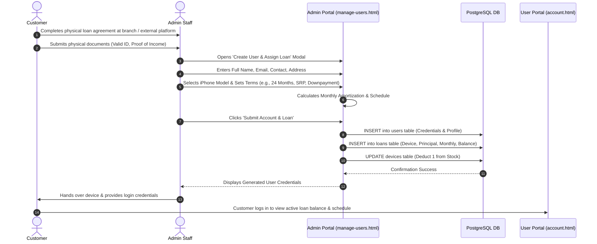
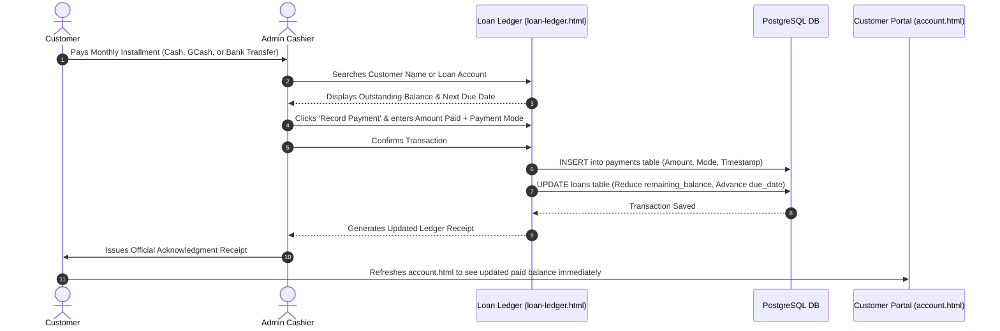
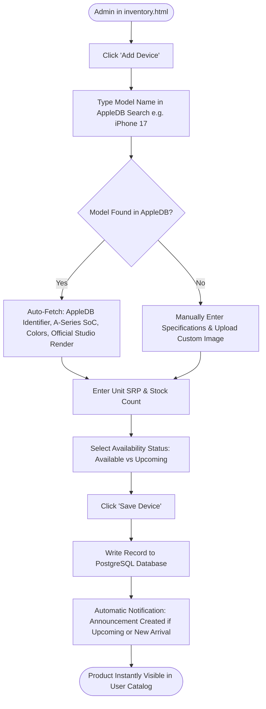
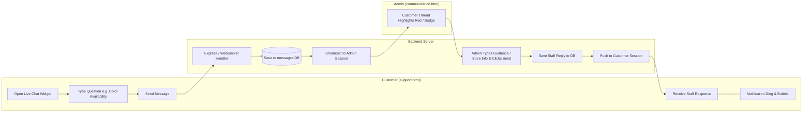

# ADC Gadgets: System Flowchart Documentation
**Author:** ADC Gadgets Development Team  
**System Architecture:** Web Application (HTML5, Vanilla CSS, JavaScript, Node.js/Express, PostgreSQL)  
**Target Roles:** User (Customer Portal) & Administrator (Admin Dashboard)

---

## Executive Summary & Scope

This document provides formal flowcharts and process diagrams for the **ADC Gadgets Management & Customer Portal System**, structured specifically according to academic and system design guidelines.

### Scope Clarification (Important System Rule)
> **Note on Loan Requests:**
> There is **no online loan request or application form** on the customer website. All loan underwriting, credit verification, and contractual agreements are conducted **face-to-face at the branch or through an external partner platform**.
> 
> The Administrator's primary responsibility in the customer module is to **create the customer account** and **directly record/assign the verified device loan** onto the system.
> 
> - **Customer Portal (`src/user/`):** Customers browse products, view authentic Apple Database (AppleDB) hardware specifications, monitor their active loan balance/payment ledger (assigned by admin), and chat with live support.
> - **Admin Portal (`src/admin/`):** Administrators create user accounts, assign verified face-to-face loans, manage device inventory with AppleDB auto-sync, record customer payments in the ledger, handle customer support inquiries, and generate business reports.

---

## 1. High-Level System Architecture Flowchart

This diagram illustrates the separation of concerns between the Customer and Administrator, both interfacing with the centralized PostgreSQL database.

---

## 2. User Portal (Customer Side) Flowchart

The User Portal flowchart illustrates the end-to-end journey of a customer accessing their portal.

### Detailed Breakdown of User Pages

| Page File | Page Title | Primary Functional Role |
| :--- | :--- | :--- |
| `src/user/login.html` | User Login & Authentication | Authenticates customer credentials; initiates user session. |
| `src/user/user-home.html` | Customer Homepage | Showcases featured gadgets, latest announcements ticker, and quick navigation. |
| `src/user/devices.html` | Device Catalog & Search | Real-time search and filtering for in-stock and upcoming iPhone models; launches detailed AppleDB specs modal. |
| `src/user/account.html` | Customer Account & Ledger | Displays borrower profile, assigned device loans, remaining balance, amortization payment ledger, and logout. |
| `src/user/support.html` | Support FAQs & Live Chat | Provides store guidelines, branch info, payment channels, and live messaging with staff. |

---

## 3. Admin Portal (Management Side) Flowchart

The Admin Portal flowchart details administrative operations: customer account provisioning, inventory control, payment recording, live customer messaging, and financial reporting.

### Detailed Breakdown of Admin Pages

| Page File | Page Title | Primary Functional Role |
| :--- | :--- | :--- |
| `src/admin/login.html` | Administrator Login | Authenticates administrator credentials and grants administrative role session. |
| `src/admin/dashboard.html` | Executive Dashboard | Overview of operational health: gross collections, active loans, low inventory alerts, and quick actions. |
| `src/admin/manage-users.html` & `user-loan.html` | User & Loan Provisioning | Form to create customer accounts and directly bind verified face-to-face device loan contracts. |
| `src/admin/inventory.html` | Inventory & AppleDB Control | Catalog management integrated with AppleDB for real-time specification auto-population, stock count, and status toggles. |
| `src/admin/loan-ledger.html` | Loan Ledger & Payment Tracking | Recording borrower monthly installments; updates balance, payment dates, and payment channel tracking. |
| `src/admin/communication.html` | Live Customer Support Desk | Centralized customer messaging desk to reply to live customer queries. |
| `src/admin/reports.html` | Financial & Business Analytics | Revenue metrics, collection efficiency, loan duration breakdown, and inventory analytics. |
| `src/admin/manage-admins.html` | Administrator Access Control | Manages staff accounts, security permissions, and system administration roles. |

---

## 4. Specific Process Flowcharts

### Sub-Flow A: Customer Account Creation & Direct Loan Assignment (Face-to-Face Agreement)

---

### Sub-Flow B: Payment Collection & Ledger Update Process

---

### Sub-Flow C: AppleDB Inventory Management Process

---

### Sub-Flow D: Real-Time Customer Support Chat Process

---

## 5. Summary of System Roles & Permissions Matrix

| Feature / Module | Customer (User Portal) | Administrator (Admin Portal) |
| :--- | :---: | :---: |
| **Browse Device Catalog with AppleDB Renders** | Read-Only | Full Control (Add, Edit, Stock, Delete) |
| **View Device Specifications (SoC, Camera, Display)** | Read-Only | Auto-Populate & Edit |
| **Account Creation** | Login to assigned account | Direct Creation & Role Assignment |
| **Device Loan Registration** | View Assigned Loan Only | Direct Binding from Face-to-Face Agreement |
| **Payment Ledger** | View Personal Ledger & Balance | Record Payments, Manage Ledger Entries |
| **Live Support Chat** | Send Inquiries to Staff | View Unified Inbox & Reply to All Clients |
| **Business Analytics & Financial Reports** | No Access | Full View, Filter, and Export (CSV/PDF) |
| **Admin Staff Accounts** | No Access | Super Admin Management |

---
*End of Documentation. Generated for academic submission and system architecture review.*
